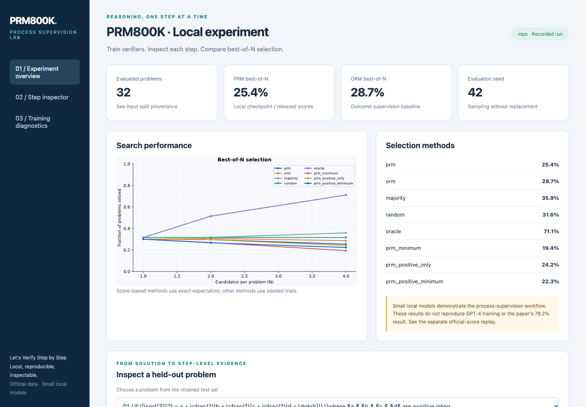
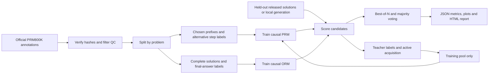
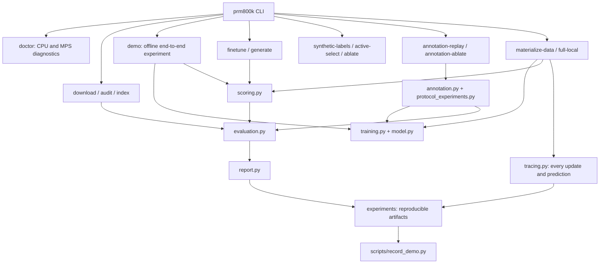
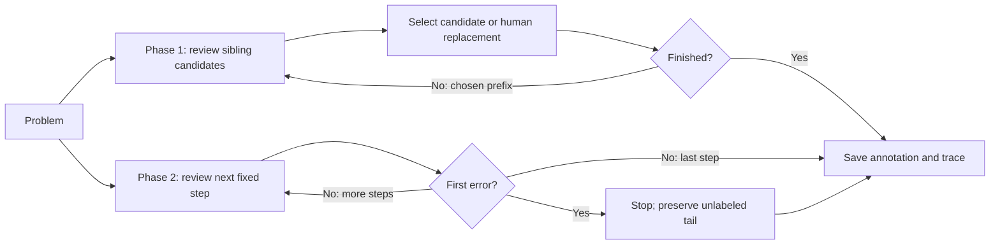

# Stepwise Lab

**English** | [简体中文](README.zh-CN.md)

A process supervision toolkit for Apple Silicon Macs, extending PRM800K with local reward model training, best-of-N reasoning evaluation, reproducible experiments, and interactive reports.

A runnable extension of OpenAI's [PRM800K release](https://github.com/openai/prm800k), accompanying [Let's Verify Step by Step](https://arxiv.org/abs/2305.20050). Train a process reward model (PRM), compare it with an outcome reward model (ORM), inspect step probabilities, and evaluate best-of-N search on an M1 Mac.

The original dataset, labeling instructions, mathematical answer grader and evaluation semantics are preserved. Original large dataset objects remain hosted by OpenAI; `.lfsconfig` preserves upstream downloads while keeping pushes directed at Stepwise Lab. The original README is archived in [docs/UPSTREAM_README.md](docs/UPSTREAM_README.md).

**Reproduction scope:** the full local workflow works on Apple Silicon. Small local models implement the paper's methods; they do **not** reproduce GPT-4 training or its reported accuracy. GPT-4 base/teacher weights, MathMix, and the original ORM training corpus were not released. Public-score replay is a separate experiment. See the [paper coverage audit](docs/REPRODUCTION.md).

## Demo

[](docs/media/demo.mp4)

<video src="docs/media/demo.mp4" controls muted playsinline width="960" poster="docs/media/demo-preview.png"></video>

[Watch/download the MP4](docs/media/demo.mp4) · [Open the local report](experiments/m1-local/report.html) · [Experiment analysis](experiments/m1-local/ANALYSIS.md)

The video records an actual CLI training run followed by report interactions. No simulated results or remote inference. GitHub may show the download link instead of an inline player; open the report locally to interact with it.

## Quick start on M1 / M2 / M3 / M4

Use **native arm64 Python 3.11**, preferably on macOS 14 or newer. The checked-in run used an **M1 Pro, 16 GiB RAM, macOS 26.6.1, Python 3.11.16, PyTorch 2.15.0**. No CUDA, paid API or cloud credentials are needed.

```bash
# Install Python 3.11 with your preferred installer, then:
GIT_LFS_SKIP_SMUDGE=1 git clone https://github.com/InfronAI/Stepwise-Lab.git
cd Stepwise-Lab
python3.11 -m venv .venv
source .venv/bin/activate
python -m pip install -e '.[train,dev]'
prm800k doctor
prm800k demo --device auto --output experiments/runs/my-demo
open experiments/runs/my-demo/report.html
```

The default experiment is **offline after installation**: it includes a small, hash-traceable subset of the real release. It trains both models, scores held-out solutions, compares eight selection policies, exports active-learning selections and synthetic labels, and writes a report. The recorded run took **23.3 seconds** on this M1 Pro; elapsed time varies with hardware and concurrent work. `--device cpu` provides a complete fallback; `--device mps` fails clearly when Metal is unavailable. Existing demo directories are protected against accidental overwrite.

To reproduce the recorded dependency environment:

```bash
python -m pip install -r requirements-m1.lock.txt
python -m pip install -e . --no-deps
pytest -q
```

The lock records the tested macOS/Python environment, including optional generation/video dependencies. The portable dependency ranges live in `pyproject.toml`.

## What is implemented

| Capability | Implementation |
|---|---|
| Data ingestion | Streaming JSONL/gzip/HTTPS; helpful LFS-pointer errors; pinned downloads with SHA-256 checks |
| Annotation semantics | All labeled alternatives, chosen-prefix reconstruction, human replacements, three classes, QC/unfinished filtering, first-error boundary |
| Annotation workflows | Phase-1 branching / phase-2 first-error state machine; official-record replay and three paired protocol experiments |
| PRM training | Causal transformer; cross-entropy at each labeled step endpoint; no ground-truth answer in the model input |
| ORM training | Final-answer labels on every solution token; final-token inference |
| PRM ranking | Log-domain probability product; neutral-as-positive default; all four product/minimum × neutral policies |
| Local generation | Frozen Qwen2.5-0.5B-Instruct with pinned revision; float32 CPU/MPS; no remote model execution |
| Generator adaptation | Memory-bounded LoRA SFT on answer-correct solutions; optional adaptation on supplied mathematical text |
| Synthetic supervision | Teacher negative-probability threshold 0.2; stop at first error; process and teacher-outcome targets |
| Active acquisition | 80% convincing wrong answers + 20% highest-scoring remaining candidates; per-problem/global budgets |
| Matched ablations | Process vs teacher-outcome vs answer-outcome; active vs uniform at equal budgets; multiple seeds |
| Evaluation | PRM, ORM, majority, random and oracle; missing generations preserved; exact score-selection expectations and seeded Monte Carlo |
| Artifacts | Checkpoints, source hashes, splits, raw predictions, confusion matrices, curves, analysis, HTML and recorded MP4 |

This project studies reward-model training and search. Generator reinforcement learning is outside the original paper's scope.

## Data flow



## Structure and execution flow



```text
prm800k/
  assets.py, io.py, data.py       # ingestion, integrity, annotation semantics
  annotation.py                 # interactive branches and first-error state transitions
  protocol_experiments.py       # paired annotation-policy experiments
  model.py, training.py          # small causal PRM / ORM, MPS / CPU
  generation.py, finetuning.py   # optional open-model generation and LoRA
  scoring.py, supervision.py     # probability aggregation and acquisition
  evaluation.py, ablations.py    # disk-backed replay and matched experiments
  experiment.py, report.py       # full local run and interactive analysis
  fixtures/                     # real offline subsets + provenance manifest
  data/, math_splits/            # original LFS assets, paths preserved
  grading/, instructions/, img/  # upstream resources
experiments/                    # checked-in measurements and model artifacts
scripts/                        # rebuild fixtures, record video, download scores
configs/                        # documented experiment recipes
tests/                         # semantic, numeric, packaging and model checks
docs/                          # coverage audit, methodology and demo video
```

## Saved experiments

| Experiment | Evidence | Interpretation |
|---|---|---|
| M1 local PRM/ORM | [Analysis](experiments/m1-local/ANALYSIS.md), [metrics](experiments/m1-local/evaluation.json), [environment](experiments/m1-local/environment.json) | 32 held-out problems / 184 candidate solutions; functional local training |
| Synthetic and active ablations | [Analysis](experiments/m1-ablations/ANALYSIS.md) | Three seeds; weak local teacher, not the paper's teacher |
| Annotation protocols | [Analysis](experiments/annotation-protocols/ANALYSIS.md), [flow and interfaces](docs/ANNOTATION_PROTOCOLS.md) | Three paired comparisons × three seeds; 18 actual MPS training runs |
| Complete protocol traces | [Analysis and parity](experiments/annotation-protocols-traced/ANALYSIS.md) | All 18 rerun metrics match; every update and prediction retained locally |
| Full-data local PRM | [Analysis](experiments/full-data-local/ANALYSIS.md), [artifact map](docs/FULL_TRACE.md) | All eligible official training labels, persisted PRM reload and complete test-candidate inference |
| Fresh local generation | [Inputs and outputs](experiments/m1-generation) | Two official held-out problems; fixed open-model revision |
| Short generation budget | [192-token outputs](experiments/m1-generation-192tokens) | Failed/incomplete attempts retained, not silently dropped |
| Local generator adaptation | [SFT and math adapters](experiments/m1-sft) | Four correct SFT examples and two text-adaptation examples; execution smoke tests |
| Official Figure 3 score replay | [Analysis](experiments/official-replay/ANALYSIS.md) | Released scores; no retraining of the original models |

At N=4 the small local PRM achieved **25.42%**, ORM **28.66%**, and sampled majority voting **35.88%** on this small, biased candidate subset. **The local PRM did not outperform ORM.** These are not benchmark claims. In particular, ORM validation accuracy of 93.02% equals its majority-class baseline; inspect balanced accuracy, macro-F1 and confusion matrices. Context truncation and class imbalance are quantified in the saved training files.

## Complete local data and every intermediate result

The complete official annotation release is now materialized locally: four raw
JSONL files and **101,599 individual JSON records**, with source and per-record
checksums. The full-data workflow trains a local PRM on every eligible training
label, reloads its saved weights, and scores every complete phase-2 test candidate.

```bash
prm800k materialize-data --output datasets/prm800k
prm800k full-local --device mps --dataset datasets/prm800k \
  --epochs 1 --context 128 --width 32 --batch-size 64 \
  --output experiments/runs/full-local
python scripts/validate_full_trace.py --run experiments/runs/full-local
python scripts/summarize_full_trace.py experiments/runs/full-local
```

Raw files: `datasets/prm800k/raw/`. Individual records:
`datasets/prm800k/records/<phase>/<shard>/<record>.json`.
The recorded run is in `experiments/full-data-local/`. Its `details/` directory
retains every batch's ordered inputs, logits/loss, raw and clipped gradients,
updated weights and AdamW state, every validation prediction, every test prefix
and its score, and every evaluation draw/winner. No checkpoint rotation is used.

These full traces require several GB locally. Raw/expanded data and bulky step
archives stay inside the local project; Git tracks manifests, record indexes,
final weights, results and representative previews. See the [artifact map and
reproduction instructions](docs/FULL_TRACE.md). The model remains a small local
transformer, not the original private GPT-4 PRM. Use `--trace` with
`annotation-ablate`, `train`, `score` or `evaluate` to retain their intermediate
results as well.

## Annotation workflows and experiments

Phase 1 records reviewed alternative steps, then continues only along the selected
candidate or adopted human replacement. Phase 2 reviews a fixed original trajectory
and stops at its first negative step. `AnnotationSession` exposes `context()`,
`submit()` and `export()`; the caller supplies candidates and review judgments.
The saved replay covers **952 official trajectories**, including **689 first-error
stops**; **5,001 subsequent steps remain without human labels**.



```bash
prm800k annotation-replay --input prm800k/fixtures/train.jsonl.gz \
  --output experiments/runs/annotation-traces.jsonl.gz
prm800k annotation-ablate --device mps --seeds 42,43,44 --budget 1024 \
  --teacher experiments/m1-local/prm.pt \
  --output experiments/runs/annotation-protocols
```

The recorded run took about **100 seconds** on M1 Pro. Within each comparison,
training arms share problem quotas, target counts, initialization and validation
data; all use the same 32 test problems / 184 candidate solutions.

| Comparison | Left / right best-of-4, mean across 3 seeds |
|---|---:|
| Phase 1: all candidates / chosen path | 27.27% / 27.85% |
| Human phase 2: include / mask first-error target | 26.18% / 27.99% |
| Synthetic: first-error stop / full trajectory | 25.62% / 26.18% |

These small experiments did not demonstrate a selection benefit from keeping
branches or the first-error target. They do not establish general superiority.
Human phase-2 data contains no post-error labels: **only the synthetic comparison
uses full-trajectory targets, all explicitly attributed to the frozen local
teacher**. Exact training subsets, checkpoints, predictions, label distributions,
paired differences and bilingual analysis are [saved with the experiments](experiments/annotation-protocols).
See [flow semantics and Python API](docs/ANNOTATION_PROTOCOLS.md). A separate
[CPU smoke run](experiments/annotation-cpu-smoke/ANALYSIS.md) verifies the fallback.

## Run individual stages

```bash
# Audit annotations or fetch full official labels (~456 MB for phase2_train).
prm800k audit prm800k/fixtures/train.jsonl.gz --output experiments/runs/audit.json
prm800k download phase1_train phase2_train phase2_test math_test

# A problem-disjoint validation split is created unless --validation is supplied.
prm800k train --train prm800k/fixtures/train.jsonl.gz --kind prm \
  --device mps --output experiments/runs/prm
prm800k train --train prm800k/fixtures/train.jsonl.gz --kind orm \
  --device mps --output experiments/runs/orm

# Candidate schema and training details:docs/METHODOLOGY.md.
prm800k score --input experiments/m1-generation/generated.jsonl.gz \
  --prm experiments/m1-local/prm.pt --orm experiments/m1-local/orm.pt \
  --output experiments/runs/scored.jsonl.gz
prm800k evaluate --input experiments/runs/scored.jsonl.gz \
  --ns 1,2,4 --method prm,orm,majority --output experiments/runs/evaluation

prm800k ablate --teacher experiments/m1-local/prm.pt --device mps \
  --seeds 42,43,44 --pool-limit 96 --output experiments/runs/ablations
```

### Fresh local generation and adaptation

The first model download is approximately 1 GB. Float32 generation and LoRA consume more memory than the tiny offline demo; the recorded host has 16 GiB. Run these stages sequentially on smaller machines.

```bash
python -m pip install -e '.[generate,finetune]'
prm800k generate --input experiments/m1-generation/problems.jsonl.gz \
  --model Qwen/Qwen2.5-0.5B-Instruct \
  --revision 7ae557604adf67be50417f59c2c2f167def9a775 \
  --device mps --samples 4 --max-new-tokens 768 \
  --output experiments/runs/generated.jsonl.gz

prm800k finetune --input experiments/m1-sft/correct_solutions.jsonl.gz \
  --revision 7ae557604adf67be50417f59c2c2f167def9a775 \
  --device mps --max-examples 4 --output experiments/runs/adapter
# Then add --adapter experiments/runs/adapter to the generate command.
# --mode math accepts JSONL objects with a "text" field for supplied math text.
```

Use `--local-files-only` for generation after downloading the pinned base. The generator receives only the problem; ground-truth answers are used afterward for grading. The default demonstration reuses released candidates, exactly as the upstream evaluation does; it does not download or run Qwen implicitly.

### Replay the public paper scores

The complete run processed **500 problems / 815,632 candidates** and reproduced
**PRM 78.2% / ORM 72.4% at N=1860**. A compressed projection of **all** evaluation
rows is included, so this check can also run offline. The four Appendix F PRM
variants also match (78.2%, 77.6%, 77.4%, 77.8%). Our explicitly normalized
majority baseline is 69.20%, versus 69.6% in the paper; the original voting
implementation was not released, and that discrepancy is documented:

```bash
prm800k index --input experiments/official-replay/scores.jsonl.gz --output .cache/offline-scores.sqlite
prm800k evaluate --database .cache/offline-scores.sqlite --population 1860 \
  --ns 10,100,1000,1860 --method prm,orm --output experiments/runs/offline-replay
```

The official file is **2,159,374,091 bytes**. A compact SQLite index avoids retaining all solution text in RAM. The parallel downloader verifies the published Azure Content-MD5; label downloads verify upstream LFS SHA-256.

```bash
python scripts/download_scores.py
prm800k index --input .cache/data/scored.jsonl --output .cache/scored.sqlite
prm800k evaluate --database .cache/scored.sqlite --population 1860 \
  --ns 1,10,25,50,100,200,500,1000,1860 --method prm,orm \
  --trials 400 --output experiments/runs/official
```

Alternatively, `prm800k index` streams directly from the public HTTPS endpoint. Downloads and SQLite files stay in `.cache/`; compact results and provenance belong in `experiments/`. **Always use `--population 1860` for the official release:** absent/incomplete generations must still count as attempts. Generic candidate files default to their stored count per problem; every requested N must fit every problem.

Exact means analytically integrate sampling without replacement and score ties. Monte Carlo uses paired draws across methods and N; each marginal distribution matches the original shuffle-based evaluator. Its standard deviation measures subsampling variability, not a population confidence interval. See [methodology](docs/METHODOLOGY.md) for formulas, validation and limits.

## Development and troubleshooting

```bash
make test
make lint
python -m build
# Optional: record another real execution; requires Chrome and ffmpeg.
python -m pip install -e '.[video]'
python scripts/record_demo.py --run-dir experiments/runs/another-video
```

- **MPS unavailable:** `prm800k doctor` should report `arm64`. Avoid a Rosetta/x86 Python. CPU mode runs the same pipeline.
- **Git LFS pointer error:** use `prm800k download ...` or install Git LFS and run `git lfs pull`. The offline fixture needs neither.
- **Insufficient memory:** use the demo first; reduce training `--context`, `--batch-size`, `--max-examples`. Full-data training streams annotations and uses bounded reservoir sampling; increase `--max-examples` deliberately.
- **No final answer:** raise generation `--max-new-tokens`. Missing answers remain failures and are exported.
- **Report on GitHub:** download/open `report.html` alongside its SVG files, or serve the experiment directory locally. GitHub shows HTML source rather than executing it.
- **Original grader:** use `from prm800k.grading.grader import grade_answer`. It remains conservative and may reject equivalent answers; it is not a proof system or an arbitrary-code sandbox.

## License and citation

Original code/data release: [MIT](LICENSE). Optional model weights retain their own license; [Qwen2.5-0.5B-Instruct](https://huggingface.co/Qwen/Qwen2.5-0.5B-Instruct) is distributed separately. Cite the original work when using PRM800K:

```bibtex
@article{lightman2023lets,
  title={Let's Verify Step by Step},
  author={Lightman, Hunter and Kosaraju, Vineet and Burda, Yura and Edwards, Harri and Baker, Bowen and Lee, Teddy and Leike, Jan and Schulman, John and Sutskever, Ilya and Cobbe, Karl},
  journal={arXiv preprint arXiv:2305.20050},
  year={2023}
}
```
