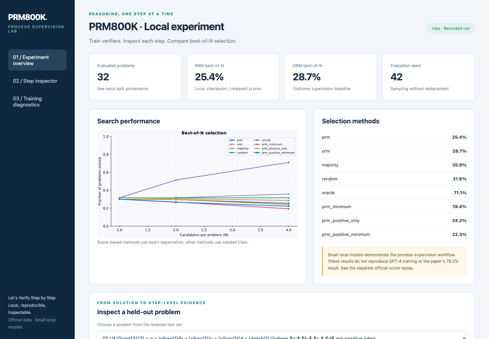
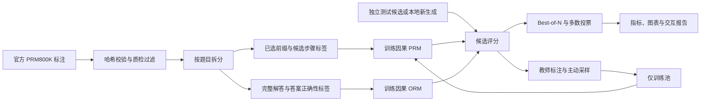
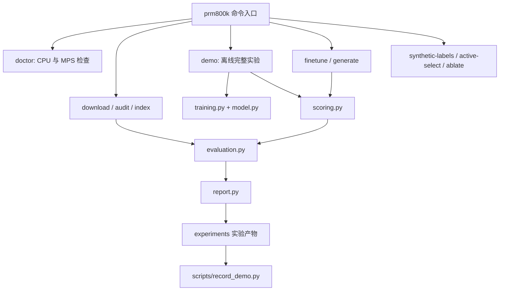

# Stepwise Lab — 在 Apple Silicon 上运行过程监督

[English](README.md) | **简体中文**

本项目基于 OpenAI 官方 [PRM800K](https://github.com/openai/prm800k) 数据发布仓库，对应论文 [Let's Verify Step by Step](https://arxiv.org/abs/2305.20050)。现在可以在 M1 Mac 上训练过程奖励模型（PRM）和结果奖励模型（ORM），逐步检查推理评分，并执行 best-of-N 候选选择实验。

保留了原始数据、标注说明、数学答案判分逻辑及评估语义。原始大数据文件仍由 OpenAI 托管；`.lfsconfig` 保留上游下载地址，并将推送指向 Stepwise Lab。原 README 完整保存在 [docs/UPSTREAM_README.md](docs/UPSTREAM_README.md)。

**复现边界：** 本地工作流已经实际跑通；小模型实现论文的方法，但不代表复现了 GPT-4 的训练与准确率。原始 GPT-4 基座、教师权重、MathMix 语料及 ORM 训练集没有公开，无法凭空补全。官方评分数据的重放与本地模型训练单独记录，详见[论文覆盖审计](docs/REPRODUCTION.md)。

## 演示视频

[](docs/media/demo.mp4)

<video src="docs/media/demo.mp4" controls muted playsinline width="960" poster="docs/media/demo-preview.png"></video>

[观看或下载 MP4](docs/media/demo.mp4) · [本地交互报告](experiments/m1-local/report.html) · [实验分析](experiments/m1-local/ANALYSIS.md)

视频记录了实际执行的训练命令，以及报告中切换题目、候选解答与训练诊断的操作。没有模拟结果，也没有调用远程推理服务。GitHub 可能仅显示下载入口；下载报告及其 SVG 文件后可在浏览器交互查看。

## 在 M1 / M2 / M3 / M4 上快速开始

建议使用 **macOS 14 或更新系统、原生 arm64 Python 3.11**。本次实测环境为 **M1 Pro、16 GiB 内存、macOS 26.6.1、Python 3.11.16、PyTorch 2.15.0**。无需 CUDA、付费 API 或云凭证。

```bash
GIT_LFS_SKIP_SMUDGE=1 git clone https://github.com/InfronAI/Stepwise-Lab.git
cd Stepwise-Lab
python3.11 -m venv .venv
source .venv/bin/activate
python -m pip install -e '.[train,dev]'
prm800k doctor
prm800k demo --device auto --output experiments/runs/my-demo
open experiments/runs/my-demo/report.html
```

依赖安装完成后，默认 demo **完全离线运行**。项目包含经过哈希校验、可追溯的官方数据子集。一次命令完成：读取数据、按题目拆分、训练 PRM/ORM、对测试解答评分、比较八种选择策略、导出主动采样和合成标注、生成报告。

首次实测约 **23.3 秒**；耗时随机器和并发任务变化。`--device cpu` 可执行同一完整流程；指定 `--device mps` 但 Metal 不可用时会明确报错。已有 demo 输出目录不会被自动覆盖。

复用本次记录的依赖版本：

```bash
python -m pip install -r requirements-m1.lock.txt
python -m pip install -e . --no-deps
pytest -q
```

锁定文件包含此次 macOS/Python 环境及可选的生成、视频依赖；通用版本范围在 `pyproject.toml` 中。

## 实现内容

| 功能 | 实现方式 |
|---|---|
| 数据读取 | 流式 JSONL/gzip/HTTPS；识别 Git LFS 指针；固定提交与 SHA-256 校验 |
| 原始标注处理 | 保留候选步骤、正确重建已选前缀、支持人工补写、保留三分类、过滤质检和未完成标注 |
| PRM 训练 | 因果 Transformer；只在标注步骤末端计算交叉熵；模型输入不包含标准答案 |
| ORM 训练 | 最终答案正确性作为每个解答 token 的标签；用最后 token 的概率评分 |
| PRM 排序 | 对数域计算概率连乘；默认中性计为正；提供连乘/最小值与中性标签的四种组合 |
| 本地生成 | 固定版本的 Qwen2.5-0.5B-Instruct，float32 CPU/MPS，无远程推理 |
| 生成器适配 | 对答案正确的解答做 LoRA SFT；支持用用户提供的数学文本做适配 |
| 合成监督 | 教师负标签概率阈值为 0.2；遇到首个错误停止；支持过程与教师结果标签 |
| 主动采样 | 80% 高评分错误解答 + 20% 其余高评分解答；支持按题或全局预算 |
| 对照实验 | 同候选的过程/教师结果/答案结果监督；等预算主动/均匀采样；多随机种子 |
| 评估 | PRM、ORM、多数投票、随机与 oracle；保留失败生成；精确期望和可复现随机试验 |
| 实验产物 | 权重、输入哈希、划分、原始预测、混淆矩阵、曲线、Markdown 分析、HTML 与视频 |

论文研究的是奖励模型训练与搜索，生成器强化学习不在原论文范围内。

## 数据流图



## 结构流程图



```text
prm800k/
  assets.py, io.py, data.py       # 数据读取、完整性和标注语义
  model.py, training.py          # 小型因果模型与 CPU/MPS 训练
  generation.py, finetuning.py   # 可选开放模型生成与 LoRA
  scoring.py, supervision.py     # 概率聚合、合成标注和主动采样
  evaluation.py, ablations.py    # 磁盘索引评估与对照实验
  experiment.py, report.py       # 一键实验与交互报告
  fixtures/                     # 真实离线子集与来源清单
  data/, math_splits/            # 保留原始 LFS 文件路径
  grading/, instructions/, img/  # 上游判分逻辑与说明资料
experiments/                    # 实验数据、模型和分析结果
scripts/                        # 重建子集、下载评分、录制视频
configs/                        # 实验运行配置说明
tests/                          # 数据语义、数值计算、模型与安装测试
docs/                           # 方法、复现审计与视频
```

## 已保存的实验

| 实验 | 证据 | 解释 |
|---|---|---|
| M1 本地 PRM/ORM | [分析](experiments/m1-local/ANALYSIS.md)、[指标](experiments/m1-local/evaluation.json)、[环境](experiments/m1-local/environment.json) | 32 道独立测试题、184 个完整候选；验证本地训练链路 |
| 合成监督与主动采样 | [分析](experiments/m1-ablations/ANALYSIS.md) | 三个随机种子；使用本地弱教师 |
| 新解答生成 | [输入与输出](experiments/m1-generation) | 两道官方测试题，固定开放模型版本 |
| 短生成预算 | [192 token 实验](experiments/m1-generation-192tokens) | 保留未完成解答和失败结果 |
| 生成器适配 | [SFT 与数学文本适配](experiments/m1-sft) | 4 个正确 SFT 样本、2 个文本样本；仅验证执行链路 |
| 官方 Figure 3 评分重放 | [分析](experiments/official-replay/ANALYSIS.md) | 使用公开分数，不表示重新训练了原始模型 |

本地小样本在 N=4 时，PRM 为 **25.42%**，ORM 为 **28.66%**，随机试验的多数投票均值为 **35.88%**。**本地小 PRM 没有超过 ORM**，这不构成完整基准结论。ORM 的 93.02% 验证准确率与多数类基线相同；请结合平衡准确率、macro-F1 和混淆矩阵查看。训练文件记录了上下文截断与类别不平衡。

## 分阶段运行

```bash
prm800k audit prm800k/fixtures/train.jsonl.gz --output experiments/runs/audit.json
prm800k download phase1_train phase2_train phase2_test math_test

# 未指定 --validation 时，按题目哈希产生独立验证集。
prm800k train --train prm800k/fixtures/train.jsonl.gz --kind prm \
  --device mps --output experiments/runs/prm
prm800k train --train prm800k/fixtures/train.jsonl.gz --kind orm \
  --device mps --output experiments/runs/orm

prm800k score --input experiments/m1-generation/generated.jsonl.gz \
  --prm experiments/m1-local/prm.pt --orm experiments/m1-local/orm.pt \
  --output experiments/runs/scored.jsonl.gz
prm800k evaluate --input experiments/runs/scored.jsonl.gz \
  --ns 1,2,4 --method prm,orm,majority --output experiments/runs/evaluation

prm800k ablate --teacher experiments/m1-local/prm.pt --device mps \
  --seeds 42,43,44 --pool-limit 96 --output experiments/runs/ablations
```

完整训练集的读取采用流式处理，训练样本通过有界蓄水池抽样限制内存。候选 JSONL 格式、评分公式和限制见[方法文档](docs/METHODOLOGY.md)。

### 本地新生成与生成器微调

首次需要下载约 1 GB 的模型。float32 生成和 LoRA 比离线小模型占用更多内存；此次主机为 16 GiB，较小内存机器应顺序执行各阶段。

```bash
python -m pip install -e '.[generate,finetune]'
prm800k generate --input experiments/m1-generation/problems.jsonl.gz \
  --model Qwen/Qwen2.5-0.5B-Instruct \
  --revision 7ae557604adf67be50417f59c2c2f167def9a775 \
  --device mps --samples 4 --max-new-tokens 768 \
  --output experiments/runs/generated.jsonl.gz

prm800k finetune --input experiments/m1-sft/correct_solutions.jsonl.gz \
  --revision 7ae557604adf67be50417f59c2c2f167def9a775 \
  --device mps --max-examples 4 --output experiments/runs/adapter
# 在 generate 命令中添加 --adapter experiments/runs/adapter 使用适配器。
# --mode math 接收每行包含 text 字段的数学文本 JSONL。
```

模型缓存完成后，可用 `--local-files-only` 禁止生成时联网下载。生成器只接收题目，标准答案仅用于后续判分。默认 demo 重用公开候选，与原始评估方式相同，不会隐式下载或启动 Qwen。

### 重放官方论文评分

完整运行处理了 **500 道题、815,632 个候选**，在 N=1860 时得到
**PRM 78.2%、ORM 72.4%**，与论文相同。附录 F 的四种 PRM 评分也匹配（78.2%、77.6%、77.4%、77.8%）。
本实现明确使用的归一化多数投票为 69.20%，论文报告为 69.6%；原始投票实现未公开，这一差异已记录。
项目包含保留全部评估行的压缩精简数据，可完全离线复核：

```bash
prm800k index --input experiments/official-replay/scores.jsonl.gz --output .cache/offline-scores.sqlite
prm800k evaluate --database .cache/offline-scores.sqlite --population 1860 \
  --ns 10,100,1000,1860 --method prm,orm --output experiments/runs/offline-replay
```

完整公开评分文件为 **2,159,374,091 字节**。紧凑 SQLite 索引只存评估字段，避免把全部解答文本留在内存。并行下载器校验 Azure Content-MD5；标注下载器校验原始 LFS SHA-256。

```bash
python scripts/download_scores.py
prm800k index --input .cache/data/scored.jsonl --output .cache/scored.sqlite
prm800k evaluate --database .cache/scored.sqlite --population 1860 \
  --ns 1,10,25,50,100,200,500,1000,1860 --method prm,orm \
  --trials 400 --output experiments/runs/official
```

也可直接执行 `prm800k index` 从 HTTPS 流式建立索引。大文件保存在 `.cache/`，可审阅结果保存在 `experiments/`。**官方重放必须指定 `--population 1860`**：未完成或缺失的生成依然占用尝试次数。普通候选文件默认使用每题实际候选数；所有 N 都必须不超过每道题的候选总数。

精确均值解析计算无放回抽样与并列评分的期望。随机评估在方法间、N 之间共用抽样，单个 N 的边际分布与原始打乱算法一致。标准差反映子样本波动，不是对全部数学题总体的置信区间。

## 开发和排错

```bash
make test
make lint
python -m build
python -m pip install -e '.[video]'
python scripts/record_demo.py --run-dir experiments/runs/another-video
```

- **MPS 不可用：** 用 `prm800k doctor` 检查是否为 `arm64`，避免 Rosetta/x86 Python；可改用 CPU。
- **LFS 指针错误：** 执行 `prm800k download ...`，或安装 Git LFS 后执行 `git lfs pull`；离线子集无需这些操作。
- **内存不足：** 先运行 demo；减少 `--context`、`--batch-size`、`--max-examples`；不要并发加载多个生成器。
- **没有最终答案：** 增加 `--max-new-tokens`。失败候选会保留并计入评估。
- **GitHub 中报告不可交互：** 将 HTML 和旁边的 SVG 下载到同一目录后打开，或在本地启动静态文件服务器。
- **原始判分器：** `from prm800k.grading.grader import grade_answer`；其规则较保守，可能拒绝等价表达式，不是形式化证明系统或任意代码沙箱。
- **重新录制视频：** 需要 Chrome 和 ffmpeg；录制脚本会真正执行一次训练。

## 许可证与引用

上游发布使用 [MIT 许可证](LICENSE)。可选模型由原作者单独提供并遵循其许可证；[Qwen 模型卡](https://huggingface.co/Qwen/Qwen2.5-0.5B-Instruct)。使用 PRM800K 时请引用原论文：

```bibtex
@article{lightman2023lets,
  title={Let's Verify Step by Step},
  author={Lightman, Hunter and Kosaraju, Vineet and Burda, Yura and Edwards, Harri and Baker, Bowen and Lee, Teddy and Leike, Jan and Schulman, John and Sutskever, Ilya and Cobbe, Karl},
  journal={arXiv preprint arXiv:2305.20050},
  year={2023}
}
```
