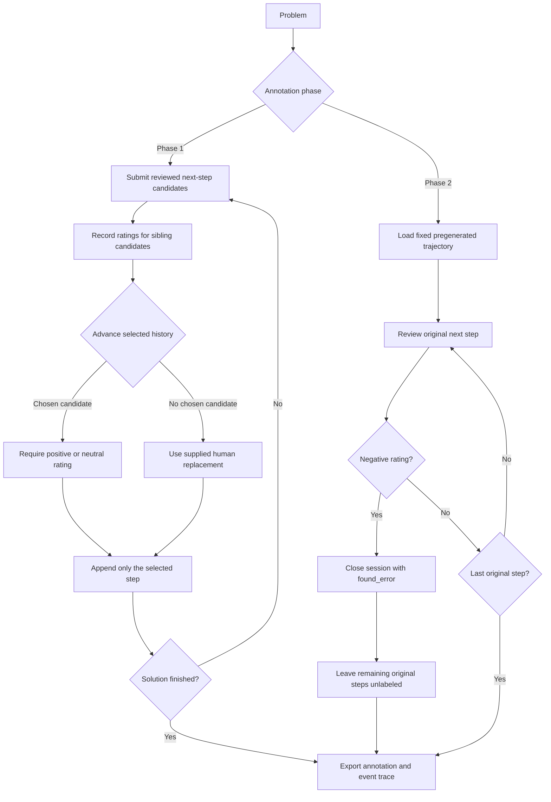

# Annotation flows and controlled experiments

[中文实验分析](../experiments/annotation-protocols/ANALYSIS.zh-CN.md) ·
[English results](../experiments/annotation-protocols/ANALYSIS.md)

The two annotation phases have different supervision boundaries. The executable
state machine in `prm800k/annotation.py` makes those boundaries explicit, and
`prm800k/protocol_experiments.py` trains paired models from traceable projections.
These are local implementations of the released schema, not a recreation of the
original labeling service or a new human-labeling campaign.

## State transitions



Phase 1 candidates at a position share the same previously selected prefix.
Unchosen siblings never become later context. A human candidate can coexist with
a chosen model candidate in the release; it replaces history only when
`chosen_completion` is null. Both string and completion-object human text forms
are supported. A negative, flagged or unrated candidate cannot be selected for
continuation. Explicit `give_up` / `bad_problem` endings are supported but excluded
from training, as in the existing data loader.

Phase 2 reviews `completions[0]` against the original step at the same index by
exact text. Terminal alternatives may duplicate the original text with a
different rating; their candidate identities remain distinct. The first negative
primary step closes the session. Additional submissions are rejected. Stored
unlabeled tail text is retained for full-solution evaluation, never converted
into human supervision.

## Python and CLI interfaces

`AnnotationSession(question, phase)` exposes `context()`, `submit(...)` and
`export()`. The caller supplies generated candidates and actual review judgments;
the state machine does not generate either. This minimal example uses illustrative
judgments solely to demonstrate the API:

```python
from prm800k.annotation import AnnotationSession

interactive = AnnotationSession({"problem": "What is 1 + 1?"}, phase=1)
interactive.submit(
    [{"text": "1 + 1 = 2", "rating": 1},
     {"text": "1 + 1 = 3", "rating": -1}],
    chosen_completion=0,
    finish_reason="solution",
)
record = interactive.export()  # Original question/label/steps structure.

fixed = AnnotationSession({
    "problem": "What is 1 + 1?",
    "pre_generated_steps": ["1 + 1 = 3", "The answer is 3."],
}, phase=2)
fixed.submit([{"text": fixed.context()["next_step"], "rating": -1}])
assert fixed.context()["status"] == "found_error"
assert len(fixed.export()["label"]["steps"]) == 1
```

Replay official annotations without model training:

```bash
prm800k annotation-replay --input prm800k/fixtures/train.jsonl.gz \
  --output experiments/runs/annotation-traces.jsonl.gz
```

Run all three comparisons on M1, using the saved local teacher:

```bash
prm800k annotation-ablate --device mps --seeds 42,43,44 \
  --split-seed 42 --budget 1024 --epochs 2 --context 256 \
  --teacher experiments/m1-local/prm.pt --teacher-pool-limit 96 \
  --output experiments/runs/annotation-protocols
```

For human labels only, omit the teacher and use
`--families phase1_branches,phase2_error_label`. `--device cpu` supports the same
workflow. `--train-input` and `--test-input` accept released-schema JSONL/gzip.
Keep a new output directory per execution. The runner checks problem disjointness
and refuses to overwrite existing evidence. The synthetic family requires the
teacher's adjacent `inputs.json` containing training problem IDs; incompatible
or missing provenance is rejected. The saved teacher uses `--split-seed 42`.

## Comparisons and controls

| Family | Left condition | Right condition | What it measures |
|---|---|---|---|
| `phase1_branches` | All rated candidates | Chosen path only | Candidate diversity at a fixed supervision budget; both retain adopted human repairs |
| `phase2_error_label` | Include the first error target | Mask that terminal target | Value of the human first-error label; both exclude terminal alternatives and unlabeled tails |
| `synthetic_horizon` | Stop at the first teacher error | Label the full original trajectory | Supervision horizon under a fixed teacher; all labels are synthetic |

The human phase-2 release cannot support a genuine human-labeled
first-error-versus-full-trajectory comparison. The second family therefore asks
a narrower question. Only the third family supplies post-error labels, explicitly
tagged `label_origin="teacher"` and `after_first_error=true`. Teacher distributions
are frozen before student training; negative probability greater than 0.2 defines
a synthetic error. The teacher's training problems must be disjoint from both
student validation and test problems.

Within each family and seed, both arms use the same architecture, initialization,
training problems, per-problem target quotas, number of optimizer updates and
validation set. Sampling is without replacement; the budget is capped by the
sum of the smaller per-problem capacities. Problems with no eligible targets in
one arm are excluded from both, with exclusions recorded. Class distributions,
sequence lengths and label diversity can still differ and are reported rather
than hidden. The experiments test equal-target budgets, not equal human effort
or equal total input tokens. Validation uses all eligible labels from the left
policy for the human families and full-trajectory teacher labels for the synthetic
family. Do not compare validation metrics across families.

The test candidates and problem split remain fixed across all runs. Exact
best-of-N integrates candidate sampling and ties; plotted variability is across
training seeds. Three seeds, 32 biased test problems and a small randomly
initialized model do not establish significance or paper-scale accuracy.

## Saved evidence

The recorded MPS run is in `experiments/annotation-protocols/`. Its replay audit
covers 952 released trajectories: 128 phase 1 and 824 phase 2, including 720
multi-candidate phase-1 events, 288 adopted human replacements and 689 first-error
stops. All 5,001 subsequent original steps remain without human labels.

Each run preserves exact training examples with trajectory/candidate provenance,
model weights, loss history and confusion matrices, test step probabilities and
selection metrics. Shared files preserve raw split trajectories, replay traces,
teacher predictions and checkpoint hash, fixed validation examples, per-problem
pairing quotas, source hashes, per-seed differences, CSV, figures and bilingual
analysis. `artifacts.json` hashes the complete result directory.

Validate the saved examples, paired controls, exact metrics and CPU checkpoint
reloads without retraining:

```bash
python scripts/validate_annotation_protocols.py experiments/annotation-protocols
```

The validator also verifies package-source hashes; use the recorded source
revision when auditing an older experiment after future code changes.
