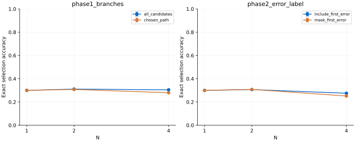

# Annotation protocol experiments

Within each family, arms share problem quotas, endpoint-target budgets, optimizer steps, seeded model initialization and validation data. Error bars are sample standard deviations across training seeds, not confidence intervals.

| Family | Condition | Training targets | Best-of-4 (mean ± SD) | Validation macro-F1 |
|---|---|---:|---:|---:|
| phase1_branches | all_candidates | 512 | 30.42% ± not estimated | 0.236 |
| phase1_branches | chosen_path | 512 | 27.92% ± not estimated | 0.208 |
| phase2_error_label | include_first_error | 512 | 27.50% ± not estimated | 0.295 |
| phase2_error_label | mask_first_error | 512 | 25.15% ± not estimated | 0.295 |

## Paired differences

| Family | Left minus right | Mean difference |
|---|---|---:|
| phase1_branches | all_candidates minus chosen_path | +2.50 percentage points |
| phase2_error_label | include_first_error minus mask_first_error | +2.35 percentage points |

## Dataset diagnostics

| Family | Condition | Available targets | Negative / neutral / positive | Post-error targets |
|---|---|---:|---|---:|
| phase1_branches | all_candidates | 5566 | 2058 / 1087 / 2421 | 0 |
| phase1_branches | chosen_path | 1788 | 0 / 0 / 1788 | 0 |
| phase2_error_label | include_first_error | 3469 | 438 / 277 / 2754 | 0 |
| phase2_error_label | mask_first_error | 3031 | 0 / 277 / 2754 | 0 |

## Interpretation and limits

- Phase 1 compares branch retention only; both arms retain human replacements and the same selected-history rule. It does not measure online labeling cost.
- The human phase-2 comparison includes or masks the first erroneous original step. Neither arm invents human labels after that error. Terminal alternatives are excluded from both arms.
- Only the synthetic family compares first-error truncation with full trajectories. Both arms use the same frozen local teacher; post-error targets are not human ground truth.
- Compare arms within a family, not across families. Equal per-problem target quotas do not equalize class balance, sequence lengths or label diversity.
- The held-out subset has 32 problems and 184 candidates; default official fixtures have active-selection bias. Models are small and trained from scratch with truncated context; 1 seeds do not establish statistical significance or general superiority.
- Exact training examples, checkpoint, all test predictions and metrics are retained per run. Pairing receipts record common quotas/exclusions and summary.json retains per-seed differences.
