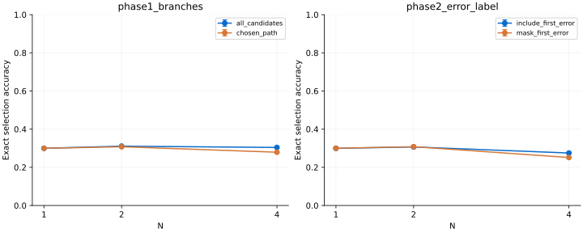

# 标注流程对照实验

每个条件使用相同模型结构、固定题目划分和 1 个训练种子；同组内采用相同的题目配额、训练目标数量、优化步数和验证集。图中误差线为训练种子间的样本标准差，不是置信区间。

| Family | Condition | Training targets | Best-of-4 (mean ± SD) | Validation macro-F1 |
|---|---|---:|---:|---:|
| phase1_branches | all_candidates | 512 | 30.42% ± not estimated | 0.236 |
| phase1_branches | chosen_path | 512 | 27.92% ± not estimated | 0.208 |
| phase2_error_label | include_first_error | 512 | 27.50% ± not estimated | 0.295 |
| phase2_error_label | mask_first_error | 512 | 25.15% ± not estimated | 0.295 |

## Paired differences

| Family | Left minus right | Mean difference |
|---|---|---:|
| phase1_branches | all_candidates minus chosen_path | +2.50 percentage points |
| phase2_error_label | include_first_error minus mask_first_error | +2.35 percentage points |

## Dataset diagnostics

| Family | Condition | Available targets | Negative / neutral / positive | Post-error targets |
|---|---|---:|---|---:|
| phase1_branches | all_candidates | 5566 | 2058 / 1087 / 2421 | 0 |
| phase1_branches | chosen_path | 1788 | 0 / 0 / 1788 | 0 |
| phase2_error_label | include_first_error | 3469 | 438 / 277 / 2754 | 0 |
| phase2_error_label | mask_first_error | 3031 | 0 / 277 / 2754 | 0 |

## 解释与边界

- 第一组只比较第一阶段候选保留策略；两组都保留人工修复，并使用相同已选前缀。不能解释为在线交互标注成本实验。
- 第二组只比较第二阶段原始轨迹的首错目标是否保留；两组均不训练首错之后的人工标签。首错处的替代候选在两组中都排除，避免引入分支数量差异。
- 第三组才比较首错截断与全轨迹，其标签全部来自同一个本地教师。错误后的目标不是人工真值；弱教师误差和错误前缀都会影响结果。
- 不同组的训练来源和验证目标不同，只能在同一组内部比较。训练按相同题目配额等量抽样，但类别比例、序列长度和可用标签多样性仍随策略变化。
- 32 道测试题、184 个候选；默认官方样本有主动学习偏置。小模型从零训练且上下文较短；1 个种子不足以支持总体优劣或统计显著性结论。
- 每个运行目录保存实际训练样本、模型、全部测试预测和指标；配对清单记录共同题目配额与排除数量，summary.json 保存逐种子差值。
