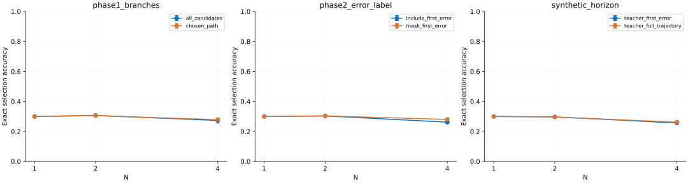

# Annotation protocol experiments

The 18 actual MPS runs took 100.1 seconds in total. None of the left-hand
conditions improved mean best-of-4 selection in this small experiment. The
differences below are observations, not evidence that branch supervision or
first-error labels are generally harmful.

Within each family, arms share problem quotas, endpoint-target budgets, optimizer steps, seeded model initialization and validation data. Error bars are sample standard deviations across training seeds, not confidence intervals.

| Family | Condition | Training targets | Best-of-4 (mean ± SD) | Validation macro-F1 |
|---|---|---:|---:|---:|
| phase1_branches | all_candidates | 1024 | 27.27% ± 1.70% | 0.237 |
| phase1_branches | chosen_path | 1024 | 27.85% ± 0.32% | 0.208 |
| phase2_error_label | include_first_error | 1024 | 26.18% ± 0.67% | 0.315 |
| phase2_error_label | mask_first_error | 1024 | 27.99% ± 1.03% | 0.295 |
| synthetic_horizon | teacher_first_error | 225 | 25.62% ± 0.21% | 0.809 |
| synthetic_horizon | teacher_full_trajectory | 225 | 26.18% ± 0.94% | 0.803 |

## Paired differences

| Family | Left minus right | Mean difference |
|---|---|---:|
| phase1_branches | all_candidates minus chosen_path | -0.58 percentage points |
| phase2_error_label | include_first_error minus mask_first_error | -1.81 percentage points |
| synthetic_horizon | teacher_first_error minus teacher_full_trajectory | -0.56 percentage points |

## Dataset diagnostics

| Family | Condition | Available targets | Negative / neutral / positive | Post-error targets |
|---|---|---:|---|---:|
| phase1_branches | all_candidates | 5566 | 2058 / 1087 / 2421 | 0 |
| phase1_branches | chosen_path | 1788 | 0 / 0 / 1788 | 0 |
| phase2_error_label | include_first_error | 3469 | 438 / 277 / 2754 | 0 |
| phase2_error_label | mask_first_error | 3031 | 0 / 277 / 2754 | 0 |
| synthetic_horizon | teacher_first_error | 225 | 96 / 0 / 129 | 0 |
| synthetic_horizon | teacher_full_trajectory | 1201 | 1016 / 0 / 185 | 976 |

## Interpretation and limits

The phase-1 chosen-path pool contains only positive labels (1,788 available;
1,024 sampled per run), whereas the all-candidate runs retain 274–294 negative
targets. Branch retention improves validation macro-F1 from 0.208 to 0.237, but
does not improve held-out final-answer selection. Token context truncation,
limited optimization and weak mathematical representations constrain this model;
these measurements do not isolate which limitation causes the ranking failure.

Masking the human phase-2 error removes every negative training target. Including
it gives validation macro-F1 0.315 versus 0.295, while best-of-4 is lower. The
paired training pool excludes 38 problems from both arms because masking their
first-step errors leaves no eligible supervision. This comparison therefore
applies only to the remaining 454 training problems.

The synthetic comparison has only 225 targets per arm, capped by the truncated
pool rather than padded to the requested 1,024. The fixed teacher calls at least
one step erroneous in all 96 sampled training trajectories. Full-path training
selects 153 / 161 / 159 post-error targets for seeds 42 / 43 / 44, all explicitly
synthetic. Its high validation macro-F1 measures agreement with this same weak
teacher, not human correctness. It cannot establish the usefulness of collecting
human labels beyond the first error.

The independent artifact validation recomputes every exact selection metric,
checks all frozen training examples against their source projection, verifies
paired quotas and hashes, and reloads all 18 checkpoints on CPU. Its maximum
sampled step-probability difference from the saved MPS output is 2.39e-7.
See [validation receipt](../annotation-protocol-validation.json).

- Phase 1 compares branch retention only; both arms retain human replacements and the same selected-history rule. It does not measure online labeling cost.
- The human phase-2 comparison includes or masks the first erroneous original step. Neither arm invents human labels after that error. Terminal alternatives are excluded from both arms.
- Only the synthetic family compares first-error truncation with full trajectories. Both arms use the same frozen local teacher; post-error targets are not human ground truth.
- Compare arms within a family, not across families. Equal per-problem target quotas do not equalize class balance, sequence lengths or label diversity.
- The held-out subset has 32 problems and 184 candidates; default official fixtures have active-selection bias. Models are small and trained from scratch with truncated context; 3 seeds do not establish statistical significance or general superiority.
- Exact training examples, checkpoint, all test predictions and metrics are retained per run. Pairing receipts record common quotas/exclusions and summary.json retains per-seed differences.
