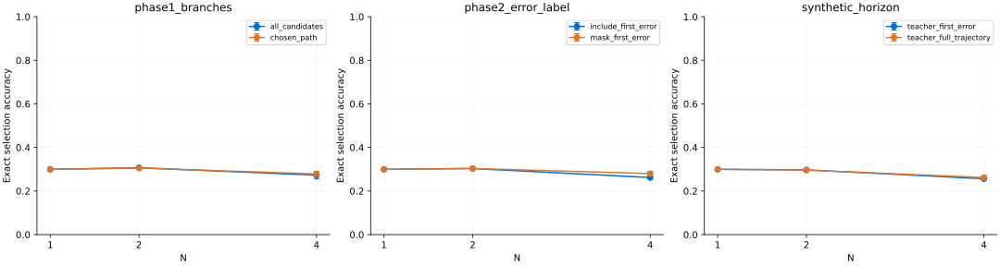

# 标注流程对照实验

18 次实际 MPS 训练及评估共耗时 100.1 秒。三个对照中，左侧条件的 best-of-4
均值均未提高。以下差异是本次小样本的观测结果，不能证明候选分支监督或首错标签一般有害。

每个条件使用相同模型结构、固定题目划分和 3 个训练种子；同组内采用相同的题目配额、训练目标数量、优化步数和验证集。图中误差线为训练种子间的样本标准差，不是置信区间。

| Family | Condition | Training targets | Best-of-4 (mean ± SD) | Validation macro-F1 |
|---|---|---:|---:|---:|
| phase1_branches | all_candidates | 1024 | 27.27% ± 1.70% | 0.237 |
| phase1_branches | chosen_path | 1024 | 27.85% ± 0.32% | 0.208 |
| phase2_error_label | include_first_error | 1024 | 26.18% ± 0.67% | 0.315 |
| phase2_error_label | mask_first_error | 1024 | 27.99% ± 1.03% | 0.295 |
| synthetic_horizon | teacher_first_error | 225 | 25.62% ± 0.21% | 0.809 |
| synthetic_horizon | teacher_full_trajectory | 225 | 26.18% ± 0.94% | 0.803 |

## Paired differences

| Family | Left minus right | Mean difference |
|---|---|---:|
| phase1_branches | all_candidates minus chosen_path | -0.58 percentage points |
| phase2_error_label | include_first_error minus mask_first_error | -1.81 percentage points |
| synthetic_horizon | teacher_first_error minus teacher_full_trajectory | -0.56 percentage points |

## Dataset diagnostics

| Family | Condition | Available targets | Negative / neutral / positive | Post-error targets |
|---|---|---:|---|---:|
| phase1_branches | all_candidates | 5566 | 2058 / 1087 / 2421 | 0 |
| phase1_branches | chosen_path | 1788 | 0 / 0 / 1788 | 0 |
| phase2_error_label | include_first_error | 3469 | 438 / 277 / 2754 | 0 |
| phase2_error_label | mask_first_error | 3031 | 0 / 277 / 2754 | 0 |
| synthetic_horizon | teacher_first_error | 225 | 96 / 0 / 129 | 0 |
| synthetic_horizon | teacher_full_trajectory | 1201 | 1016 / 0 / 185 | 976 |

## 解释与边界

第一阶段“仅选中路径”的可用池全部为正标签（共 1,788 个，每次抽取 1,024 个）；
“全部候选”的每次训练则保留 274–294 个负标签。保留分支使验证 macro-F1 从
0.208 提高到 0.237，但未提高最终答案选择准确率。上下文截断、训练预算和模型数学
能力都有限；这些数据不能区分究竟是哪项限制导致排序效果不佳。

屏蔽人工第二阶段首错标签会移除全部负训练标签。保留首错时，验证 macro-F1 为
0.315，高于屏蔽时的 0.295，但 best-of-4 更低。有 38 道训练题在屏蔽第一步错误后
没有可用标签，因此两侧同时排除；该对照只适用于剩下的 454 道训练题。

合成对照受截断池容量限制，两侧实际均为 225 个目标，没有重复补齐到请求的 1,024 个。
固定教师在抽取的全部 96 条训练轨迹中都至少判出一个错误。全轨迹条件在种子
42 / 43 / 44 下分别抽到 153 / 161 / 159 个首错后目标，全部明确标记为合成标签。
较高的验证 macro-F1 衡量的是与同一弱教师的一致性，不是与人工真值的一致性，
不能用来证明采集首错之后人工标签的价值。

独立产物校验已重新计算全部精确选择指标，逐条核对训练样本来源、配对题目配额与哈希，
并在 CPU 重载全部 18 个权重；抽查步骤概率与保存的 MPS 输出最大差异为 2.39e-7。
详见[校验记录](../annotation-protocol-validation.json)。

- 第一组只比较第一阶段候选保留策略；两组都保留人工修复，并使用相同已选前缀。不能解释为在线交互标注成本实验。
- 第二组只比较第二阶段原始轨迹的首错目标是否保留；两组均不训练首错之后的人工标签。首错处的替代候选在两组中都排除，避免引入分支数量差异。
- 第三组才比较首错截断与全轨迹，其标签全部来自同一个本地教师。错误后的目标不是人工真值；弱教师误差和错误前缀都会影响结果。
- 不同组的训练来源和验证目标不同，只能在同一组内部比较。训练按相同题目配额等量抽样，但类别比例、序列长度和可用标签多样性仍随策略变化。
- 32 道测试题、184 个候选；默认官方样本有主动学习偏置。小模型从零训练且上下文较短；3 个种子不足以支持总体优劣或统计显著性结论。
- 每个运行目录保存实际训练样本、模型、全部测试预测和指标；配对清单记录共同题目配额与排除数量，summary.json 保存逐种子差值。
