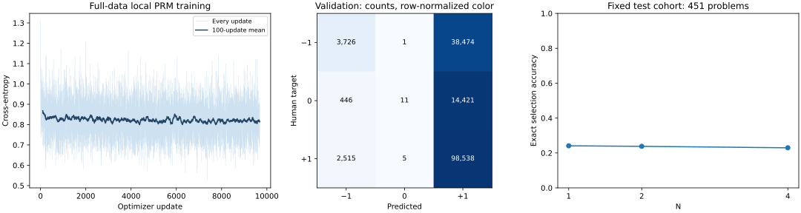

# Full local PRM training and inference

| Metric | Value |
|---|---:|
| Training step labels | 619,636 |
| Validation step labels | 158,137 |
| Optimizer updates / saved states | 9,682 / 9,683 |
| Test problems / complete candidates | 457 / 2,664 |
| Test reasoning-step predictions | 33,864 |
| Validation accuracy / majority baseline | 64.67% / 63.91% |
| Validation balanced accuracy / macro-F1 | 0.355 / 0.311 |
| Top selection from all available candidates | 23.41% |
| Full intermediate storage | 6.24 GiB |

Fixed >=4-candidate cohort: 451 of 457 problems.

| N | Exact selection accuracy |
|---|---:|
| 1 | 24.11% |
| 2 | 23.80% |
| 4 | 22.96% |

All eligible training-source labels are partitioned by problem without an example cap. Training executes locally and inference reloads the final checkpoint. Full intermediates are local under `details/`; GitHub retains manifests, final weights, every-update CSV, charts, verification and representative `preview/` files.

This is a randomly initialized width-32 PRM with 128 byte-token context and one epoch. Interpret validation accuracy alongside its majority-class baseline and macro-F1. All-available selection has varying pool sizes; fixed-N comparisons use the same >=4-candidate cohort. Official annotation candidates have active-selection bias and do not reproduce the paper score benchmark.

[Detailed artifact map](../../docs/FULL_TRACE.md) · [Validation receipt](validation.json) · [Trace index](trace_index.json)

Validation accuracy is within two percentage points of the majority-class baseline. Balanced accuracy and macro-F1 expose the weak discrimination; dominant-class predictions are not reliable mathematical verification.

On the same test cohort, best-of-4 did not exceed the exact N=1 expectation. This run validates complete execution and traceability, not improved candidate selection.
