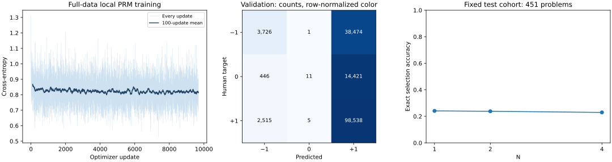

# 完整本地 PRM 训练与推理

| Metric | Value |
|---|---:|
| Training step labels | 619,636 |
| Validation step labels | 158,137 |
| Optimizer updates / saved states | 9,682 / 9,683 |
| Test problems / complete candidates | 457 / 2,664 |
| Test reasoning-step predictions | 33,864 |
| Validation accuracy / majority baseline | 64.67% / 63.91% |
| Validation balanced accuracy / macro-F1 | 0.355 / 0.311 |
| Top selection from all available candidates | 23.41% |
| Full intermediate storage | 6.24 GiB |

Fixed >=4-candidate cohort: 451 of 457 problems.

| N | Exact selection accuracy |
|---|---:|
| 1 | 24.11% |
| 2 | 23.80% |
| 4 | 22.96% |

完整训练源经题目拆分后产生 619,636 个训练标签和 158,137 个验证标签，未做数量截断。模型在本机训练，推理重新加载最终权重。所有逐步中间结果位于本地 `details/`；GitHub 保留清单、最终权重、逐更新 CSV、图表、校验记录及 `preview/` 示例。

这是宽度 32、上下文 128 字节 token、从零训练一轮的小型 PRM；验证准确率需要结合多数类基线和 macro-F1 解读。全候选选优的每题候选数不同，不能与固定 N 的指标混为一谈；best-of-N 只在相同的至少四候选题目子集上比较。测试候选来自官方主动采样标注集，并不构成论文原始评分基准的复现。

[Detailed artifact map](../../docs/FULL_TRACE.md) · [Validation receipt](validation.json) · [Trace index](trace_index.json)

验证准确率与多数类基线相差不到两个百分点，需结合较低的平衡准确率和 macro-F1 判断；不能把高占比正类上的预测当作可靠数学验证能力。

在同一测试题子集上，增加到 best-of-4 没有超过 N=1 的精确期望准确率。本次验证了完整执行与记录链路，没有证明该小模型能改善候选选择。
